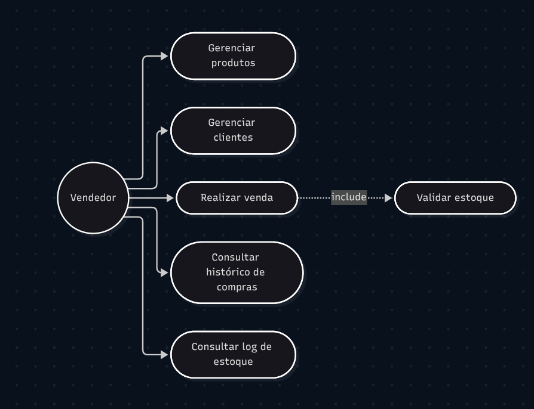
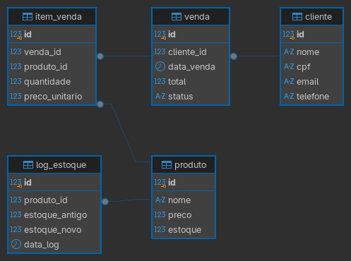

# Sistema de Vendas com Controle de Estoque

Trabalho de **Banco de Dados II (2026.2)**: Procedures, Functions e Triggers com App.
IFPI Campus Picos. Prof. João Paulo.

**Integrantes:** 
- José Neres
- Marcos Vinícius 
- Júlio Henrique

## Sobre o projeto

Aplicação de terminal em **Python** conectada a um banco **PostgreSQL**. Ela cadastra
clientes e produtos, realiza vendas com baixa automática de estoque e mantém um
histórico de alterações de estoque. A venda é feita por uma **Procedure** que controla
a transação: se qualquer passo falhar, tudo é desfeito (**ROLLBACK**); se tudo der certo,
é confirmado (**COMMIT**).

## Requisitos e funcionalidades

- Cadastrar, listar, atualizar e excluir **produtos** (CRUD)
- Cadastrar, listar, atualizar e excluir **clientes** (CRUD)
- Realizar **venda** com vários itens e baixa de estoque, com validação e transação
- Consultar o **histórico de compras** de um cliente e os itens de cada venda
- Consultar o **log de estoque**, preenchido automaticamente pelo banco

### Diagrama de casos de uso



## Banco de dados

### Diagrama entidade-relacionamento



### Recursos do PostgreSQL usados

| Recurso | Nome | O que faz | Onde é chamado no app |
|---|---|---|---|
| **Procedure** | `sp_realizar_venda` | Cria a venda, valida cada item, baixa o estoque e faz COMMIT ou ROLLBACK | `vendas.py` → `realizar_venda()` |
| **Function** (escalar) | `fn_estoque_disponivel` | Retorna o estoque atual de um produto | `vendas.py` → `estoque_disponivel()` |
| **Function** (escalar) | `fn_total_venda` | Soma quantidade × preço dos itens da venda | `vendas.py` → `total_venda()` |
| **Function** (tabela) | `fn_vendas_cliente` | Retorna o histórico de vendas de um cliente | `relatorios.py` → `historico_cliente()` |
| **Trigger** | `trg_produto_log_estoque` | Grava em `log_estoque` toda mudança de estoque | automático (relatório em `relatorios.py`) |

A Procedure usa `fn_estoque_disponivel` e `fn_total_venda` na sua implementação.
A baixa de estoque é feita pela Procedure; o Trigger só registra a auditoria.

O **CRUD** está em `produtos.py` e `clientes.py` (comandos `INSERT`, `SELECT`, `UPDATE` e `DELETE`).

## Estrutura do projeto

```
main.py                  menu principal
db.py                    conexão com o PostgreSQL (autocommit ligado)
config_local.example.py  modelo de configuração (copiar para config_local.py)
utils.py                 leitura e validação das entradas
produtos.py              CRUD de produtos
clientes.py              CRUD de clientes
vendas.py                chamada da Procedure e das Functions escalares
relatorios.py            Function de tabela e log do Trigger
script.sql               criação do banco: tabelas, dados de teste, functions, procedure e trigger
requirements.txt         dependência do projeto (psycopg2-binary)
docs/                    diagramas (DER e casos de uso) e roteiro da apresentação
testes/                  evidências (prints) dos testes, organizadas por recurso
```

## Testes

As evidências dos testes (prints da execução) estão na pasta [`testes/`](testes/),
organizadas por recurso: CRUD, Procedure (COMMIT e ROLLBACK), Function, Trigger e integridade.
O arquivo [`testes/README.md`](testes/README.md) explica o que cada pasta comprova.

## Como executar

**Requisitos:** Python 3.9+ e PostgreSQL 11+.

1. Crie o banco e rode o script:
   ```sql
   CREATE DATABASE loja_vendas;
   ```
   Conecte-se ao banco `loja_vendas` e execute o arquivo `script.sql` como script.
   Atenção: o script apaga e recria as tabelas.

2. Instale a dependência:
   ```
   python3 -m pip install -r requirements.txt
   ```

3. Configure a conexão. Copie o arquivo `config_local.example.py` para
   `config_local.py` e coloque a senha do seu PostgreSQL nele:
   ```
   cp config_local.example.py config_local.py
   ```
   O `config_local.py` está no `.gitignore` e não vai para o repositório.
   Alternativamente, o `db.py` aceita as variáveis de ambiente `DB_HOST`,
   `DB_PORT`, `DB_NAME`, `DB_USER` e `DB_PASSWORD`.

4. Execute:
   ```
   python3 main.py
   ```

> A conexão usa `autocommit = True` porque a Procedure executa `COMMIT` e `ROLLBACK`
> por conta própria. Em modo de transação manual o PostgreSQL retornaria o erro
> `invalid transaction termination`.
